<p align="center">
  <picture>
    <source media="(prefers-color-scheme: dark)" srcset=".github/assets/banner-en-dark.webp">
    
  </picture>
</p>

<p align="center">
  <a href="https://www.npmjs.com/package/sitelens"></a>
  <a href="LICENSE"></a>
</p>

<p align="center"><a href="README.md">Wersja polska</a></p>

sitelens checks a website's performance, SEO, accessibility and security, then explains in a plain-language PDF report what to fix, why it matters and who fixes it. Every result comes from a specific test, and every piece of advice from a hand-written card, not from a language model.

## Getting started

The easiest way is the browser: paste an address at [sitelens.pl/en/audit](https://sitelens.pl/en/audit) and choose the report language, English or Polish. The online version checks up to 10 pages in the same four areas and needs no installation. The terminal gives you more data: up to 50 pages, a certificate check, the full set of axe-core accessibility rules on each page after its JavaScript runs, and up to 150 links checked:

```sh
npx sitelens
```

Run on its own, with no address or options, sitelens asks for the report language, the website address and the audit mode. At the end it shows where it saved the report and opens it when you press Enter.

<p align="center">
  
</p>

You need Node.js 22.19 or newer and a Chromium-based browser (Chrome, Edge, Brave or Chromium). If you have none, `npx sitelens --install-browser` downloads Chromium. In Windows PowerShell, type `npx.cmd` instead of `npx`.

No Node.js? One command installs sitelens together with Node.js in your user folder, with no administrator password:

```sh
# macOS and Linux
curl -fsSL https://sitelens.pl/install.sh | sh
```

```powershell
# Windows (PowerShell)
irm https://sitelens.pl/install.ps1 | iex
```

Then type `sitelens` in a new terminal window, or `sitelens --install-browser` if no browser was found. [Step-by-step guide for macOS, Windows and Linux](https://sitelens.pl/en/terminal).

With an address, the wizard does not open, and options work only together with an address:

```sh
npx sitelens https://yourwebsite.com --lang en
npx sitelens https://yourwebsite.com --lang en --out report.pdf
npx sitelens https://yourwebsite.com --lang en --pages 30 --json
```

| Option | What it does |
|---|---|
| `--pages <number>` | how many pages to check (default 10, at most 50) |
| `--lang pl\|en` | report language (default pl) |
| `--out <file.pdf>` | where to save the report (default `raport.pdf`, or `report.pdf` with `--lang en`) |
| `--json` | also saves the raw results as JSON |
| `--fail-under <score>` | exits with an error when the overall score is lower (for CI) |
| `--install-browser` | downloads Chromium (about 150 MB); needed only when the computer has no Chrome, Edge, Brave or Chromium |

## What it checks

| Area | What it checks | Checked with |
|---|---|---|
| Performance | How fast the main content appears, whether the layout shifts and how quickly the page responds to a click. Page weight, image size and format, files that delay rendering, server response time and compression. | Lighthouse on a phone, the homepage also on a computer |
| SEO | Page titles, descriptions for Google and headings, image descriptions, sitemap and robots.txt, pages blocked for search engines, canonical addresses, one address for the site (with and without www, over http and https), redirects, broken pages and internal links, the link preview when shared, the site icon. | sitelens tests |
| Accessibility | Text contrast, image descriptions, form field labels, link and button names, page language, fit to a phone screen, zoom blocking and the other WCAG 2.2 AA rules that can be checked automatically. | axe-core and sitelens tests |
| Security | HTTPS and the redirect from http, the certificate, files and forms without encryption, security headers (HSTS, CSP, protection against framing and others), exposed software versions. | sitelens tests |

Plus: whether contact details are easy to find and the phone number and e-mail are clickable, whether every page links to the privacy policy, and whether all images and videos load. These three are in the report but do not affect the score yet.

## The report

<p align="center">
  
</p>

The report opens with the score and five things to start with. Then each critical and important problem gets a card: what is wrong, why it matters, how to fix it, who fixes it and how much work it is. Minor problems get a short card: what to fix, who fixes it and how much work it is. It ends with a technical appendix of identifiers, details and page addresses for the developer. [Report design (PDF, in Polish)](https://sitelens.pl/raport/przykladowy-raport.pdf)

Performance is the average Lighthouse score of the pages checked. On the homepage the phone counts for 70% and the computer for 30%; other pages are measured on a phone only. SEO, accessibility and security start at 100 points, and each problem takes a share of what is left: critical 25%, important 10%, minor 3%, less when it affects only some of the pages. The overall score is the average of the four areas, or of those that could be measured. Thresholds and weights live in [`scoring.ts`](packages/core/src/config/scoring.ts).

## Brandbook

A separate tool: sitelens reads the logo, colours, typography, buttons and navigation and the tone of voice of a live website and puts them into a PDF brandbook with tokens ready for code. The easiest way is the browser: [sitelens.pl/en/brandbook](https://sitelens.pl/en/brandbook). In the terminal the brandbook gets screenshots of the dark theme, the buttons and the navigation straight from the site, and it also works for sites built with JavaScript:

```sh
npx sitelens brand https://yourwebsite.com --lang en
```

The command saves a `brandbook-<domain>/` folder and the same as a ZIP:

| File | What it holds |
|---|---|
| `brandbook.pdf` | landscape A4 pages: cover, logo, colours, colours in use, typography, interface, dark theme (when the site has one) and tone of voice |
| `brandbook.html` | the same sections as a page that works offline: clicking a colour copies its HEX, RGB or CMYK value, and there are buttons to copy `font-family` stacks and a token preview |
| `tokens.json` | colours by role, typefaces, text styles and corner radii in the [Design Tokens](https://www.designtokens.org/) format, with dark theme values |
| `tokens.css` | the same tokens as CSS variables; the dark theme works through `prefers-color-scheme` and `[data-theme=dark]` |
| `tailwind.css` | a Tailwind CSS 4 theme (an `@theme` block, classes such as `bg-<brand>-accent`); the dark theme swaps the variables themselves, so the classes need no `dark:` |
| `logo/` | the site's logo and icon files unchanged, with the address each came from in `SOURCES.md` |
| `screenshots/` | the site on a computer and a phone, the dark theme, the navigation and the buttons |
| `README.md` | what the package holds, what is fact and what is a proposal, and licensing |

| Option | What it does |
|---|---|
| `--out <folder>` | where to save the brandbook (default `brandbook-<domain>`) |
| `--lang pl\|en` | brandbook language (default pl) |
| `--pages <number>` | how many pages from the navigation to compare with the homepage (default 2, at most 10) |
| `--format <list>` | which files to save: `pdf`, `html`, `tokens`, `zip`, `json` (default `pdf,html,tokens,zip`) |

What is read from the site, the brandbook states as fact. Clear space, minimum sizes, don'ts and the description of the brand's character are proposals labelled “proposal” and wait for a person to decide. We include no font files, only the typeface name and source. The brand's typeface goes into the PDF only when its license allows it (for example OFL); otherwise the type sample is a picture taken on the site. The HTML version embeds no brand typefaces and shows those pictures. Logos and marks belong to the brand owner.

## In GitHub Actions

The `--fail-under` option stops the build when the score drops below the threshold, and the report is saved as an artifact.

```yaml
name: sitelens
on:
  push:
    branches: [main]
  pull_request:
jobs:
  audit:
    runs-on: ubuntu-latest
    steps:
      - uses: actions/setup-node@v7
        with:
          node-version: 24
      - run: npx --yes sitelens https://yourwebsite.com --lang en --fail-under 80
      - uses: actions/upload-artifact@v7
        if: always()
        with:
          name: sitelens-report
          path: report.pdf
```

## Privacy

sitelens runs entirely on your computer and sends us nothing. The audit is passive: it fetches only what a regular visitor would see, the public pages and files, and it follows robots.txt. It does not log in, does not submit forms and does not attack the site to test its security. sitelens requests carry its name and the address of this repository in the User-Agent header. Lighthouse speed measurements are the exception: they present themselves as a regular Chrome on a phone or computer.

In the online version, the address of the site goes to Google PageSpeed Insights, and its public content passes through our proxy ([`apps/proxy`](apps/proxy), a Cloudflare Worker) only for the audit and is not stored. The report is made in your browser. Online, the certificate cannot be checked and accessibility is judged by the rules Lighthouse runs, so the full audit is the one in the terminal.

The online brandbook works the same way: the page code, styles, fonts and logo files pass through the proxy only while it works, the site is displayed in your browser without running its scripts, and the screenshots come from PageSpeed Insights. The brandbook, tokens and package are made in your browser and we store none of them.

## Development

| Folder | What it holds |
|---|---|
| [`packages/core`](packages/core) | checks, scoring and advice cards; no network or Node APIs, so it also runs in the browser |
| [`packages/crawl`](packages/crawl) | finding and fetching pages, shared by the CLI and the online version |
| [`packages/collect-node`](packages/collect-node) | data collection in Node: Chromium, Lighthouse, axe-core |
| [`packages/collect-web`](packages/collect-web) | data collection in the browser: the proxy and Google PageSpeed Insights; the online brandbook in a frame without scripts |
| [`packages/brand`](packages/brand) | reading and analysing a brand from a site; the rules (token filters, colour names, logo patterns, tone) are data files with tests |
| [`packages/report`](packages/report) | the report and the brandbook in HTML and PDF, the brandbook's tokens and package |
| [`packages/cli`](packages/cli) | the `sitelens` and `sitelens brand` commands |
| [`apps/site`](apps/site) | the sitelens.pl website (Astro), with the online versions at `/audit` and `/brandbook` |
| [`apps/proxy`](apps/proxy) | the online version's proxy (a Cloudflare Worker): fetches public pages, styles, fonts and images for the browser |
| [`fixtures/sites/broken`](fixtures/sites/broken) | a test site with deliberate problems |
| [`fixtures/sites/brand`](fixtures/sites/brand) | a test brand site for the brandbook |

```sh
pnpm install
pnpm test        # without Lighthouse
pnpm typecheck
pnpm lint
pnpm build:cli   # then: node packages/cli/dist/cli.js https://yourwebsite.com
```

`SITELENS_SKIP_LIGHTHOUSE=1` before an audit command skips Lighthouse, and performance is then reported as not measured. You need Node.js 22.19 or newer (the website needs 22.23.4 or newer) and pnpm at the version in the `packageManager` field.

To add a check:

1. Write it in [`packages/core/src/checks`](packages/core/src/checks) and add it to the list at the end of its file, for example `seoChecks` in `seo.ts`. A check receives the already collected page data and does not call the network.
2. Add an advice card in `packages/core/cards` at the path of the check's id (`seo/title` → `cards/seo/title.yaml`), with Polish and English text and the same placeholders in both languages, and run `pnpm cards`.
3. Keep thresholds in [`scoring.ts`](packages/core/src/config/scoring.ts) and describe the behaviour with a test in [`packages/core/test`](packages/core/test).

Report ideas and bugs in [Issues](https://github.com/revize-studio/sitelens/issues).

## License

[MIT](LICENSE). Built by [Revize Studio](https://revize.pl/en).
