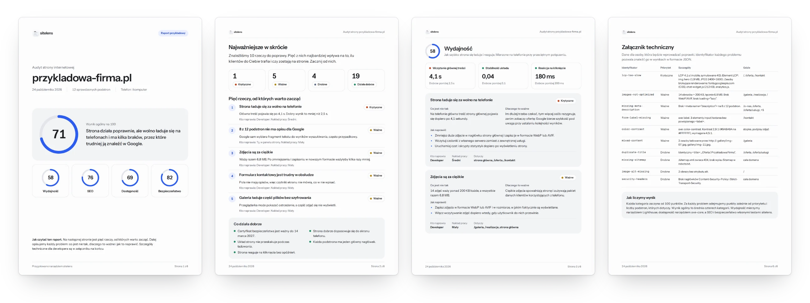

<p align="center">
  <picture>
    <source media="(prefers-color-scheme: dark)" srcset=".github/assets/banner-pl-dark.webp">
    
  </picture>
</p>

<p align="center">
  <a href="https://www.npmjs.com/package/sitelens"></a>
  <a href="LICENSE"></a>
</p>

<p align="center"><a href="README.en.md">English version</a></p>

sitelens sprawdza wydajność, SEO, dostępność i bezpieczeństwo strony, a potem w raporcie PDF prostym językiem mówi, co poprawić, dlaczego to ważne i kto to naprawi. Każdy wynik pochodzi z konkretnego testu, a każda porada z ręcznie napisanej karty, nie z modelu językowego.

## Uruchomienie

Najprościej w przeglądarce: wklej adres na [sitelens.pl/audyt](https://sitelens.pl/audyt) i wybierz język raportu, polski albo angielski. Wersja online sprawdza do 10 podstron w tych samych czterech obszarach i niczego nie trzeba instalować. Więcej danych da terminal: do 50 podstron, sprawdzenie certyfikatu, pełny zestaw reguł dostępności axe-core na stronie po uruchomieniu JavaScriptu i do 150 sprawdzonych linków:

```sh
npx sitelens
```

Uruchomiony bez adresu i bez opcji sitelens zapyta o język raportu, adres strony i tryb audytu, a na koniec pokaże, gdzie zapisał raport, i otworzy go po naciśnięciu Enter.

<p align="center">
  
</p>

Potrzebny jest Node.js 22.19 lub nowszy i przeglądarka oparta na Chromium (Chrome, Edge, Brave albo Chromium). Jeśli żadnej nie masz, `npx sitelens --install-browser` pobierze Chromium. W PowerShellu na Windows wpisz `npx.cmd` zamiast `npx`.

Nie masz Node.js? Jedna komenda zainstaluje sitelens razem z Node.js w Twoim folderze użytkownika, bez hasła administratora:

```sh
# macOS i Linux
curl -fsSL https://sitelens.pl/install.sh | sh
```

```powershell
# Windows (PowerShell)
irm https://sitelens.pl/install.ps1 | iex
```

Potem w nowym oknie terminala wpisz `sitelens`, a gdy brakuje przeglądarki, `sitelens --install-browser`. [Instrukcja krok po kroku dla macOS, Windows i Linuxa](https://sitelens.pl/terminal).

Z adresem kreator się nie otwiera, a opcje działają tylko razem z adresem:

```sh
npx sitelens https://twojastrona.pl
npx sitelens https://twojastrona.pl --lang en --out report.pdf
npx sitelens https://twojastrona.pl --pages 30 --json
```

| Opcja | Co robi |
|---|---|
| `--pages <liczba>` | ile podstron sprawdzić (domyślnie 10, najwyżej 50) |
| `--lang pl\|en` | język raportu (domyślnie pl) |
| `--out <plik.pdf>` | gdzie zapisać raport (domyślnie `raport.pdf`, a z `--lang en` `report.pdf`) |
| `--json` | zapisuje też surowe wyniki w formacie JSON |
| `--fail-under <wynik>` | kończy się błędem, gdy wynik ogólny jest niższy (do CI) |
| `--install-browser` | pobiera Chromium (ok. 150 MB); potrzebne tylko wtedy, gdy na komputerze nie ma Chrome, Edge, Brave ani Chromium |

## Co sprawdza

| Obszar | Co sprawdza | Czym |
|---|---|---|
| Wydajność | Jak szybko pojawia się główna treść, czy układ nie skacze i jak szybko strona reaguje na kliknięcie. Waga strony, rozmiar i format zdjęć, pliki, które opóźniają wyświetlenie, czas odpowiedzi serwera i kompresja. | Lighthouse na telefonie, strona główna także na komputerze |
| SEO | Tytuły, opisy dla Google i nagłówki podstron, opisy zdjęć, mapa strony i robots.txt, blokady dla wyszukiwarek, adresy kanoniczne, jeden adres strony (z www i bez, przez http i https), przekierowania, niedziałające podstrony i linki wewnątrz strony, podgląd linku przy udostępnianiu, ikona strony. | testy sitelens |
| Dostępność | Kontrast tekstu, opisy obrazów, etykiety pól formularzy, nazwy linków i przycisków, język strony, dopasowanie do ekranu telefonu, blokada powiększania i pozostałe reguły WCAG 2.2 AA, które da się sprawdzić automatycznie. | axe-core i testy sitelens |
| Bezpieczeństwo | HTTPS i przekierowanie z http, certyfikat, pliki i formularze bez szyfrowania, nagłówki bezpieczeństwa (HSTS, CSP, ochrona przed osadzaniem w ramce i inne), ujawniane wersje oprogramowania. | testy sitelens |

Do tego: czy łatwo znaleźć kontakt i czy telefon i e-mail są klikalne, czy każda podstrona ma link do polityki prywatności i czy wszystkie obrazy i filmy się wczytują. Te trzy rzeczy są w raporcie, ale nie wpływają jeszcze na wynik.

## Raport

<p align="center">
  
</p>

Raport zaczyna się od wyniku i pięciu rzeczy, od których warto zacząć. Potem każdy krytyczny i ważny problem dostaje kartę: co jest nie tak, dlaczego to ważne, jak to naprawić, kto to naprawia i ile to pracy. Drobne problemy dostają krótką kartę: co poprawić, kto to naprawia i ile to pracy. Na końcu jest załącznik techniczny z identyfikatorami, szczegółami i adresami podstron dla developera. [Wzór raportu (PDF)](https://sitelens.pl/raport/przykladowy-raport.pdf)

Wydajność to średnia wyników Lighthouse ze sprawdzonych podstron. Na stronie głównej telefon liczy się w 70%, a komputer w 30%, inne podstrony są mierzone tylko na telefonie. SEO, dostępność i bezpieczeństwo zaczynają od 100 punktów, a każdy problem zabiera część tego, co zostało: krytyczny 25%, ważny 10%, drobny 3%, mniej, gdy dotyczy tylko części podstron. Wynik ogólny to średnia czterech obszarów, a gdy któregoś nie udało się zmierzyć, średnia pozostałych. Progi i wagi są w [`scoring.ts`](packages/core/src/config/scoring.ts).

## Brandbook

Osobne narzędzie: z działającej strony sitelens odczytuje logo, kolory, typografię, przyciski i nawigację oraz ton komunikacji i składa z nich brandbook w PDF z tokenami gotowymi do kodu. Najprościej w przeglądarce: [sitelens.pl/brandbook](https://sitelens.pl/brandbook). W terminalu brandbook ma zrzuty ciemnego motywu, przycisków i nawigacji prosto ze strony i działa też dla stron budowanych JavaScriptem:

```sh
npx sitelens brand https://twojastrona.pl
```

Komenda zapisuje folder `brandbook-<domena>/` i to samo jako ZIP:

| Plik | Co zawiera |
|---|---|
| `brandbook.pdf` | strony A4 w poziomie: okładka, logo, kolory, kolory w praktyce, typografia, interfejs, ciemny motyw (gdy strona go ma) i ton komunikacji |
| `brandbook.html` | te same sekcje jako strona działająca bez internetu: kliknięcie koloru kopiuje HEX, RGB albo CMYK, są też przyciski do kopiowania `font-family` i podgląd tokenów |
| `tokens.json` | kolory według ról, kroje, style tekstu i zaokrąglenia w formacie [Design Tokens](https://www.designtokens.org/), z wartościami ciemnego motywu |
| `tokens.css` | te same tokeny jako zmienne CSS; ciemny motyw działa przez `prefers-color-scheme` i `[data-theme=dark]` |
| `tailwind.css` | motyw dla Tailwind CSS 4 (blok `@theme`, klasy w rodzaju `bg-<marka>-accent`); ciemny motyw podmienia same zmienne, więc klasy nie potrzebują `dark:` |
| `logo/` | pliki logo i ikon ze strony bez zmian, a w `ZRODLA.md` adres, z którego pochodzi każdy z nich |
| `zrzuty/` | strona na komputerze i telefonie, ciemny motyw, nawigacja i przyciski |
| `README.md` | co jest w paczce, co jest faktem, a co propozycją, i kwestie licencji |

| Opcja | Co robi |
|---|---|
| `--out <folder>` | gdzie zapisać brandbook (domyślnie `brandbook-<domena>`) |
| `--lang pl\|en` | język brandbooka (domyślnie pl) |
| `--pages <liczba>` | ile podstron z nawigacji porównać ze stroną główną (domyślnie 2, najwyżej 10) |
| `--format <lista>` | które pliki zapisać: `pdf`, `html`, `tokens`, `zip`, `json` (domyślnie `pdf,html,tokens,zip`) |

To, co odczytane ze strony, brandbook podaje jako fakt. Pole ochronne, minimalne rozmiary, zakazy i opis charakteru marki są propozycjami z etykietą „propozycja” i czekają na decyzję człowieka. Plików fontów nie dołączamy, tylko nazwę i źródło kroju. Krój marki trafia do PDF tylko wtedy, gdy jego licencja na to pozwala (np. OFL), a w innym razie próbka kroju jest obrazem ze strony. Wersja HTML nie osadza żadnych krojów marki, tylko pokazuje te obrazy. Logo i znaki należą do właściciela marki.

## W GitHub Actions

Opcja `--fail-under` zatrzyma build, gdy wynik spadnie poniżej progu, a raport trafi do artefaktów.

```yaml
name: sitelens
on:
  push:
    branches: [main]
  pull_request:
jobs:
  audit:
    runs-on: ubuntu-latest
    steps:
      - uses: actions/setup-node@v7
        with:
          node-version: 24
      - run: npx --yes sitelens https://twojastrona.pl --fail-under 80
      - uses: actions/upload-artifact@v7
        if: always()
        with:
          name: raport-sitelens
          path: raport.pdf
```

## Prywatność

sitelens działa w całości na Twoim komputerze i niczego nam nie wysyła. Audyt jest pasywny: pobiera tylko to, co zobaczy zwykły odwiedzający, czyli publiczne podstrony i pliki, i trzyma się pliku robots.txt. Nie loguje się, nie wysyła formularzy i nie atakuje strony, żeby sprawdzić jej zabezpieczenia. Zapytania sitelens mają w nagłówku User-Agent jego nazwę i adres tego repozytorium. Wyjątkiem są pomiary Lighthouse, które przedstawiają się jak zwykły Chrome na telefonie albo komputerze.

W wersji online adres sprawdzanej strony trafia do Google PageSpeed Insights, a jej publiczna treść przechodzi przez nasz pośrednik ([`apps/proxy`](apps/proxy), Cloudflare Worker) tylko na czas audytu i nie jest zapisywana. Raport powstaje w Twojej przeglądarce. Online nie da się sprawdzić certyfikatu, a dostępność jest oceniana regułami, które uruchamia Lighthouse, więc pełny audyt daje terminal.

Brandbook online działa tak samo: kod strony, style, fonty i pliki logo przechodzą przez pośrednik tylko na czas pracy, strona jest wyświetlana w Twojej przeglądarce bez uruchamiania jej skryptów, a zrzuty ekranu pochodzą z PageSpeed Insights. Brandbook, tokeny i paczka powstają w przeglądarce i nigdzie ich nie zapisujemy.

## Rozwój

| Folder | Co zawiera |
|---|---|
| [`packages/core`](packages/core) | sprawdzenia, punktacja i karty porad; bez sieci i API Node, więc działa też w przeglądarce |
| [`packages/crawl`](packages/crawl) | szukanie i pobieranie podstron, wspólne dla CLI i wersji online |
| [`packages/collect-node`](packages/collect-node) | zbieranie danych w Node: Chromium, Lighthouse, axe-core |
| [`packages/collect-web`](packages/collect-web) | zbieranie danych w przeglądarce: pośrednik i Google PageSpeed Insights; brandbook online w ramce bez skryptów |
| [`packages/brand`](packages/brand) | odczyt marki ze strony i jej analiza; reguły (filtry tokenów, nazwy barw, wzorce logo, ton) są plikami danych z testami |
| [`packages/report`](packages/report) | raport i brandbook w HTML i PDF, tokeny i paczka brandbooka |
| [`packages/cli`](packages/cli) | komendy `sitelens` i `sitelens brand` |
| [`apps/site`](apps/site) | strona sitelens.pl (Astro) z wersją online pod `/audyt` i `/brandbook` |
| [`apps/proxy`](apps/proxy) | pośrednik wersji online (Cloudflare Worker): pobiera publiczne strony, style, fonty i obrazy za przeglądarkę |
| [`fixtures/sites/broken`](fixtures/sites/broken) | strona testowa z celowymi błędami |
| [`fixtures/sites/brand`](fixtures/sites/brand) | strona testowa marki dla brandbooka |

```sh
pnpm install
pnpm test        # bez Lighthouse
pnpm typecheck
pnpm lint
pnpm build:cli   # potem: node packages/cli/dist/cli.js https://twojastrona.pl
```

`SITELENS_SKIP_LIGHTHOUSE=1` przed komendą audytu pomija Lighthouse, a wydajność ma wtedy status „nie zmierzono”. Potrzebny jest Node.js 22.19 lub nowszy (strona wymaga 22.23.4 lub nowszego) i pnpm w wersji z pola `packageManager`.

Nowe sprawdzenie:

1. Dopisz je w [`packages/core/src/checks`](packages/core/src/checks) i dodaj do listy na końcu pliku, np. `seoChecks` w `seo.ts`. Sprawdzenie dostaje już pobrane dane strony i nie woła sieci.
2. Dodaj kartę porady w `packages/core/cards`, pod ścieżką równą identyfikatorowi sprawdzenia (`seo/title` → `cards/seo/title.yaml`), z tekstem po polsku i angielsku i tymi samymi zmiennymi w obu językach, i uruchom `pnpm cards`.
3. Progi trzymaj w [`scoring.ts`](packages/core/src/config/scoring.ts), a zachowanie opisz testem w [`packages/core/test`](packages/core/test).

Pomysły i błędy zgłaszaj w [Issues](https://github.com/revize-studio/sitelens/issues).

## Licencja

[MIT](LICENSE). Zbudowane przez [Revize Studio](https://revize.pl).
